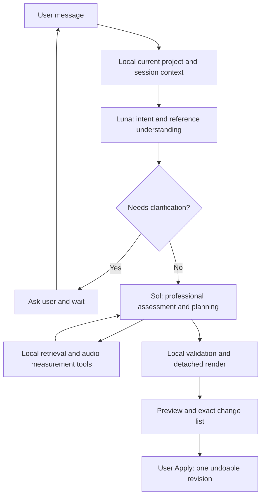

# SoniLoom — Intent, Context and Professional Planning

Date: 2026-10-05
Status: Design for review; not implemented. No release version is assigned.
Implementation baseline: `140fc0c`, v0.6 foundation on package version 0.5.0.

## Implementation note — 2026-10-21

The target runtime described below is still deferred. `src/intent-contract.mjs`, `src/agent-context.mjs` and `server/intent.mjs` now provide the internal Plan A foundation, tested through an injected mock invoker. They do not yet connect Luna to the UI or live provider coordinator. Catalog retrieval now includes embedded descriptions and title diversity, with bounded metadata evidence sent to the existing Sol planner. Current execution still permits four Sol calls and three retrieval rounds. No real-provider or human-listening acceptance is implied by these updates.

## 1. Decisions and scope

One SoniLoom Agent uses two model roles through the local Node service and OpenAI Responses API:

- `gpt-6-luna`: understand user language, resolve references using current context, extract intent and constraints, and ask clarification questions when it does not understand.
- `gpt-6.1-sol`: all professional material assessment, retrieval strategy, sound-design analysis, arrangement and processing decisions.
- Owned local code: read audio, calculate measurements, search installed content, validate decisions, extract clips, process and render audio, and apply revisions.

These are stages of one coordinated agent, not two independent autonomous agents. Luna translates language into a professional task description; it does not select recordings, decide DSP parameters, or substitute for Sol even on simple professional edits. Sol reasons from permitted evidence, not from listening to raw audio.

User-confirmed limits: Luna at most 3 calls, Sol at most 3 calls, local retrieval at most 3 rounds. These are separate ceilings, not targets. Clarification conversation has no fixed round limit: Luna decides when it needs to ask. Memory is restricted to the current project and session; no cross-project or long-term personal memory.

This document defines future behavior only. It does not change HTTP routes, configuration, schemas, existing spending guards or runtime behavior. No code, executable skill, model installation, library migration or paid verification is delivered by this document update. SoniLoom remains independent of Lyra.

## 2. Current implementation versus target

| Area | Current implementation | Target design |
| --- | --- | --- |
| Model use | Single Sol planner | Luna intent stage followed by Sol professional stage |
| Context | Current project summary and recent bounded conversation | Explicit project/session-scoped facts, references, corrections and intent |
| Analysis | Whole-source local measurements and heuristic intervals | Preserve these; propose bounded selected-interval measurements for professional assessment |
| Planning | Search/arrange/unavailable decisions using fixed DSP | Same execution capabilities, with explicit intent and evidence responsibilities |
| Calls | Up to 4 Sol calls and 3 searches | Separate ceilings of 3 Luna, 3 Sol and 3 searches |
| Clarification | No dedicated Luna stage | Luna asks when unclear and waits for the user |
| Memory | Session-local conversation; no durable semantic memory | Project/session-scoped contextual records; persistence beyond this session is excluded from the initial design |

The deployed application has not adopted the target model roles or limits. The older architecture in V0.6-ENGINEERING-DESIGN.md is historical/deferred direction; this document supersedes its future role division, context policy and call-budget direction only. It does not activate local semantic audio models, free routing or human annotation subsystems.

## 3. Flow and authority

Only the local coordinator dispatches models/tools and enforces counters, cancellation and stale-state checks. Context helps resolve a request; it never grants broader write authority. Luna output is model interpretation, not an authoritative project fact. Sol receives the original user text as well as interpreted intent and the current project snapshot, allowing it to expose contradictions rather than blindly inherit a paraphrase.

Existing selected-layer scope, locks, source identity and Apply/Discard behavior remain mandatory. Neither model can mark its own proposal as applied. Rejected, discarded and outdated proposals remain distinguishable from actual project state.

## 4. Context and session memory

### Local ownership

The local application owns the current project state, selected layer, revision generation and proposal outcome. Luna may extract relevant conversational information; it cannot invent or overwrite these facts.

Initial scope is the active project within the active session. No new durable memory store, project-file field, cross-project index or automatic preference learning is included. New/Open, project replacement or session restart must not carry old referents into a new project. The project itself still persists through existing Save/Open; conversation memory is not promised to survive reload. Longer-lived project memory would need a separately approved persistence design.

### Proposed ContextEnvelope

| Field | Purpose |
| --- | --- |
| `sessionId`, `projectId`, `generation` | Local identity and stale-state anchor |
| `scope`, `selectedLayerId` | Existing user-selected operation boundary |
| `projectFacts` | Bounded canonical layer/source/lock/parameter data from local code |
| `turns` | Relevant user statements and actual proposal outcomes, with turn IDs |
| `corrections` | User corrections linked to the statements they supersede |
| `taskAssumptions` | Explicitly labeled assumptions, never promoted to user facts |
| `pendingClarification` | Question and unresolved referent/requirement for this task |

This is a proposed internal contract, not a new public endpoint. The cloud projection is separately allowlisted and bounded. No WAV bytes, disk paths, full library catalog or new audio representations are included. Session context selection must preserve the original text supporting a critical constraint; summaries cannot create authority.

Manual edits, Undo and Redo refresh canonical project facts and invalidate incompatible pending plans. Conversation may remember that an earlier proposal existed but must not describe it as the current project after Undo. Layer names alone are not stable identity; ambiguous or missing targets are not guessed into write authority.

## 5. Luna skill: intent and context

Input: current user text and bounded ContextEnvelope.

Proposed IntentRecord:

- `requestId`, `sessionId`, `projectId`, `baseGeneration` assigned by local code.
- `originalText` retained alongside the interpretation.
- `intentKind`: new sound, revise sound, discuss, clarify or cancel.
- `targetRefs`: proposed resolutions to existing IDs, with supporting turn/selection references.
- `requestedOutcome`: meaning of the change, not chosen processing parameters.
- `preserveConstraints`: explicit unchanged objects/dimensions with supporting user text.
- `contextReferences`, `corrections`, `unknowns` and `assumptions` kept distinct.
- `status`: ready or needs_clarification; `question` when necessary.

Luna decides whether it understands enough to proceed. Do not hard-code a maximum number of questions or force a guess after repeated clarification. Asking a question pauses processing until the user responds; it is not an autonomous retry. Local validators still reject nonexistent targets or inconsistent identities even if Luna reports ready.

Example: “Same gunshot; make the room smaller and leave the gunshot unchanged.” Luna resolves the sound and preserves source identity, reporting the desired smaller perceived space. It must not decide a decay of 0.4 seconds or select another recording. Those are Sol decisions.

If Sol exposes a professional ambiguity, return that specific unresolved point to Luna for a user-facing question within the remaining Luna call allowance. If none remains, show the structured unresolved issue without another model call and await user input. No fabricated understanding is used to continue.

## 6. Sol skill: professional assessment and planning

Input: original user text, validated IntentRecord, relevant canonical context, engine capabilities and bounded local candidate evidence.

Sol owns keyword strategy, interpretation of measurements, comparison of candidate segments, source choice, layer timing and all DSP decisions. It can request local searches and selected-interval measurements. It may output a plan, request more permitted evidence, identify missing material or return a professional ambiguity.

Candidate assessments must separate catalog claims, measured facts and model inferences. Include candidate handle, interval identity, evidence references, suitability rationale, uncertainty and missing requirements. A transient is not proof of a gunshot; numerical decay is not proof of a garage. No invented confidence percentages or claims of listening.

An internal ProfessionalPlan should carry request/project/generation identity, capability version, chosen candidate references, affected layers/fields, preservation constraints, existing supported operations, rationale and limitations. Reuse the validated existing edit operation contract where possible. This document does not approve an arbitrary processing graph or a project-schema migration.

Sol cannot broaden scope merely because extra layers would improve the sound. If the user asks for room-only edits, preserve the source and unrelated parameters and skip library retrieval unless the user changes that requirement.

## 7. Local tools and execution

Local code owns waveform analysis, source verification and mutations. Model “analysis” means interpreting allowed metadata and measurements; it is distinct from computing measurements on audio.

Proposed selected-interval measurements should identify source hash, exact frame range, sample rate, measurement profile and coverage. Do not present whole-source statistics as clip statistics. Retain bounded reads and cache identity; no full-library reanalysis is implied. Exact metric definitions are implementation-plan work, not silently accepted accuracy claims.

Before rendering, validate scope, locks, candidate handles, source bounds, supported DSP, project capacity and generation freshness. Materialize into a detached proposal. Apply remains explicit and atomic; Undo restores the prior project. No hidden normalization, source substitution, arbitrary generated code or unregistered DSP is allowed.

Tool errors return concrete failures. No new automatic paid repair loop is authorized. Runtime failures must not be reclassified as a user's clarification answer.

## 8. Calls, clarification and spending

Define an execution attempt as automatic processing triggered by one submitted user message. A multi-turn clarification task may contain multiple attempts linked by the same task identity.

| Counter | Ceiling per execution attempt |
| --- | --- |
| Luna provider calls | 3 |
| Sol provider calls | 3 |
| Local retrieval rounds | 3 |

Counters do not reset on a stage transition, failed provider request, tool failure or internal continuation. Submitted provider attempts count even if they time out or fail. An actual new user message starts a new attempt; it does not reset the durable spending ledger. There is no aggregate limit on user-facing clarification rounds and no model polling while waiting for an answer.

These maxima are not a fixed sequence of nine actions. Stop early when enough evidence is available. In a sequential Sol loop, an initial search request, a second search request and a final plan already use all 3 Sol calls while consuming only 2 retrieval rounds. Three retrieval rounds do not entitle the agent to a fourth Sol call to inspect the last results. The coordinator must expose remaining calls and reserve room for a final decision; if exhausted without a valid plan, stop without applying anything.

No dollar estimate, new price table, spending cap increase or paid test allowance is approved by this design. Actual usage varies with model, context, output and clarification turns. Future budgeting must distinguish each model's usage and failed/unknown attempts, while preserving existing reservations. A call-count ceiling is not a financial cap. Current budget code stays unchanged; multi-model pricing/reservation handling must be specified before implementing paid dispatch. Lack of a cost estimate is not unlimited spending authorization.

## 9. What is borrowed from Lyra and SoundRack

Read-only source inspection on 2026-10-05, Lyra checkout HEAD `f59878e`. This is static local source evidence, not a runtime or production claim. Paths below are relative to the separate Lyra repository and are references only; contributors need no Lyra checkout to run SoniLoom.

| Inspected source | Observed mechanism | SoniLoom adaptation |
| --- | --- | --- |
| `midi-lab/src/lyra_midi_lab/daw_agent_context.py`, `build_agent_project_context_snapshot` | Validates project/session identity and exact revision/HEAD before producing context | Bind context to local ProjectStore project/generation; reject stale work |
| `docs/lyra-agent-project-context-feature-record-v0.1.md` | Context is read-only evidence and does not expand write scope | Keep context resolution separate from mutation authority |
| `soundrack/src/lyra_soundrack/service.py`, `revise` | Loads exact parent candidate/patch hash, plans from that parent and identifies affected/preserved dimensions | Anchor follow-up edits to actual current source/project; enumerate preservation |
| `soundrack/src/lyra_soundrack/revision_candidates.py`, `revision_options` | Constrains alternatives to the same parent and a narrowly eligible change | Never silently regenerate unrelated content when revising |

Inspection does not establish a reusable general memory subsystem or existing Luna-based context feature in Lyra. SoniLoom session-memory design is proposed here, not attributed to those files. Do not copy Lyra's server-owned DAW/Run schema: SoniLoom's editable project currently lives in the browser. No shared service, account, database or runtime dependency is introduced.

## 10. Skill specifications and future implementation sequence

Skill specifications consist of instructions, allowed tools, input/output contracts, stop conditions and representative examples. They are not just Markdown prompts; local validation enforces hard boundaries.

| Future stage | Expected components | Why |
| --- | --- | --- |
| Context and intent contracts | `src/conversation.mjs`, proposed context/intent modules and validators | Establish scoped evidence and reference resolution before dispatch |
| Model roles and budget support | `server/ai.mjs`, `server/budget.mjs`, `server/arrangement.mjs` | Separate Luna/Sol instructions, counters and accounting |
| Professional evidence and planning | `server/audio-analysis.mjs`, `server/analysis-store.mjs`, `server/library-search.mjs`, `src/library-ai-contract.mjs` | Provide clip-specific evidence and validated professional decisions |
| Conversation lifecycle and preview | `src/conversation.mjs`, `src/arrangement.mjs`, existing project validation | Clarification pause/resume, stale checks and exact Apply behavior |

These are planning targets, not approval to edit these files. No new endpoint or persistence format is assumed. API access, reasoning settings and per-model reservation policy must be resolved before paid implementation verification; no monetary estimates are invented here.

## 11. Future acceptance requirements (not executed)

- Luna returns intent/reference evidence without independently selecting sources or DSP parameters.
- Sol receives original wording and authoritative project facts, not only Luna's paraphrase.
- Ambiguous references trigger a question; the conversation may continue beyond three user-facing questions without an arbitrary clarification limit.
- Per-attempt model/search ceilings are enforced, including failure paths, without background calls during user wait.
- New/Open, manual edits, Undo and Redo cannot reuse stale target identity or applied-state claims.
- Unapplied proposals and user corrections retain distinct status; current-project memory cannot leak into another project.
- Source tags, full-source measurements, segment measurements and inference remain distinguishable.
- Unsupported DSP, invented candidate IDs and scope violations fail before project mutation.
- Preview/Apply/Undo retain existing semantics; original WAV and bundle bytes remain unchanged.
- Provider payload inspection verifies allowlists; raw audio remains local.
- Automated contract tests, browser interactions, actual provider behavior and human listening are separate evidence levels. No one level proves another.

Document completion means consistent responsibilities, explicit limits, bounded context scope and linked baseline/target descriptions. It does not mean code implementation, provider access or sound quality acceptance. This update performs no tests, paid calls, commits, pushes or PR actions. Implementation requires a separately approved plan on a separate update branch.
