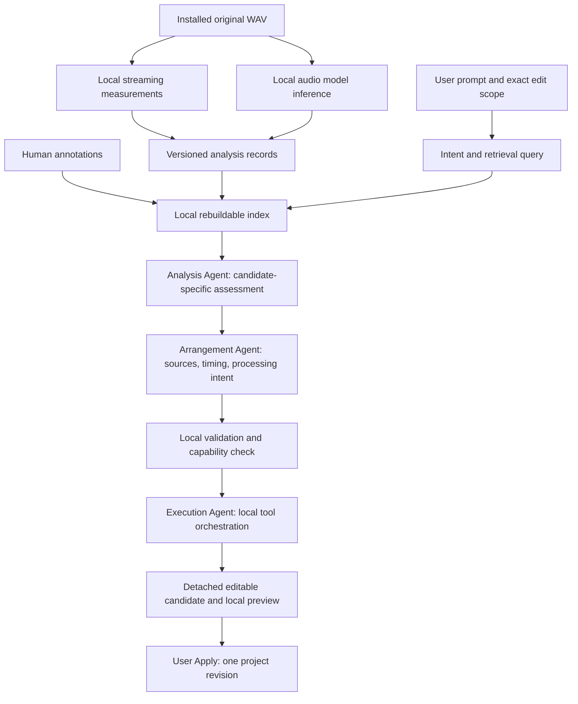

# SoniLoom v0.6 — Local Audio Intelligence and Agent Arrangement

Date: 2026-10-05
Status: Engineering design with approved foundation implementation scope (2026-10-05); see the decision update below.
Baseline: inspected local package version 0.5.0, Git HEAD `21e7865`, including existing uncommitted Library work. HEAD alone does not represent this baseline.

## Current handoff status — 2026-10-05

The foundation is implemented, not the entire architecture below. Runtime/package labels remain v0.5. Current coordination uses one `gpt-6.1-sol` planner with local deterministic analysis/retrieval and execution; independent material-evaluation and arrangement skills remain discussion only.

Subsequent authorized live testing produced a rendered arrangement from a locally seeded candidate shortlist, with save/reopen and Undo/Redo checks. The initial automatic search failed because its queries were overconstrained. Search guidance was repaired and regression-tested, but the complete real-provider flow after that repair and a real-provider room-only follow-up remain unverified. The owner reported that the resulting example lacked convincing gunshot identity and garage space. Audible realism is not accepted. No new paid verification is part of this documentation handoff.

See [README](../README.md) for setup and [local API](LOCAL-API.md) for implemented contracts. The overnight verification restrictions below are historical scope, not a prohibition on the subsequently authorized commit/push handoff. Do not treat future architecture sections as active implementation instructions.

## Approved decision update — 2026-10-05

The following decisions supersede the model/permission gates and semantic-model acceptance items later in this original design:

- Use existing bundle names, categories and tags as semantic retrieval evidence. No audio semantic model, model installation or whole-library AI relabeling in v0.6.
- Owned local code measures audio and estimates event intervals. It does not claim to identify a recording's material, weapon type, room or background noise by listening.
- Cloud planning may receive bounded candidate tags and measurement summaries plus task-relevant project context. Raw audio, paths and the full catalog remain local.
- At most three retrieval rounds per user request, including the initial search. A new technical failure does not reset the counter. A request may need up to four model calls (initial decision, then one decision after each search); spending is independently bounded by the existing ledger.
- Free processing graphs are deferred for discussion. This implementation uses existing DSP modules, order and project limits only.
- Approved implementation: analysis records/cache/rebuildable index, bounded resumable batches, tag retrieval, three-round planning, detached preview and atomic Apply/Undo, focused UI and README updates.
- Tonight's verification uses mocked provider responses and a paid-AI-disabled local QA server. No paid API calls, whole-library scan, source/bundle changes, branch creation, commit, push or external-account operations.

Initial implementation limits: 20 assets per explicit analysis batch; 5 source files (up to 2 estimated intervals each) per search; fresh automatic analysis only for sources at most 60 seconds, with a 120-second combined source-duration cap per search. Longer sources remain catalog-only candidates until explicitly analyzed. Records use full-source peak/RMS, activity and first-order filter band-energy estimates; these are not true peak, LUFS, spectral classification or semantic recognition. Activity boundaries use 10 ms windows at -60 dBFS and 100 ms gaps, with at most 128 retained events. Candidate extraction is still bounded by existing WAV/project limits.

Persistent per-file job checkpoints allow explicit Resume after interruption or cancellation. Active jobs block root switching until cancelled or completed. Analysis indexing never rewrites human-supplied catalog tags. There is no new human-annotation editor or annotation persistence schema in this foundation.

Automatic full-library import analysis and render-priority scheduling are deferred in this foundation: explicit batches and bounded on-demand measurement are implemented. Record identity is versioned, but no semantic-model or human-annotation layer is introduced.

The sections below retain the broader architecture and deferred direction for discussion. A3 (local semantic inference) and model-selection-dependent parts of Stage 0/2/3 do not apply to this approved foundation. A6/A15 remain human evaluation requirements; automated tests cannot establish semantic accuracy or audible realism.

## Implemented foundation versus deferred architecture

The local implementation now follows the approved foundation, with these concrete interfaces:

| Area | Implemented module / behavior |
| --- | --- |
| Measurements | `server/audio-analysis.mjs`: `analyzeWav`, `hashFile`, content/profile analysis key; whole-source measurements and estimated energy intervals |
| Records and jobs | `server/analysis-store.mjs`: `AnalysisStore`, atomic record/index persistence, explicit bounded batches and per-file Resume |
| Retrieval | `server/library-search.mjs`: `LibrarySearch`, persisted index lookup, request-local candidate handles, three-search cap, source verification at extraction |
| Cloud boundary | `src/library-ai-contract.mjs`: strict search/arrange/unavailable decisions and candidate-summary allowlist |
| Coordination | `server/arrangement.mjs`: at most four existing-provider calls, three local searches, no retries/fallback |
| Project preparation | `src/arrangement.mjs` plus `src/ai-contract.mjs`: verified clips, detached candidate, preview, atomic Apply/Undo and stale checks |
| UI | Local analysis/search panel, optional cloud library checkbox, candidate evidence, proposal audio preview and schema acceptance |

Transport uses the existing library resolver field `version`; persisted project provenance retains `bundleVersion`. Analysis records use `profile` as a versioned string and `measurements.coverage: "full"`. Proposed richer record/plan shapes below remain design sketches; they are not the implemented wire schema. Cloud plans reuse validated existing operations, and temporary candidate IDs are materialized locally into embedded hashes. No standalone arbitrary ArrangementPlan graph is accepted.

Known limits of this foundation: automatic onset boundaries are heuristic; lexical English bundle-label retrieval has no synonym/translation model; no semantic audio recognition, annotation editor, auto-import scan, cross-process render-priority scheduler or free routing is added. Selected-layer scope and locked-layer protections are enforced locally, while nuanced natural-language preservation still requires checking the exact proposal diff. Real provider behavior and human listening remain unverified by this overnight implementation; mocked provider tests are not substitutes.

The original future architecture below is retained for design discussion. Its model-dependent stages and broader contracts must not be executed unless separately approved. The approved update and implemented mapping above take precedence.

## 1. Objective and authority

Build an explainable path from a conversational request to locally selected, arranged, processed and editable sound. Every library recording receives a local analysis record; an index makes those records searchable. Analysis, Arrangement and Execution have distinct responsibilities and exchange validated data.

The original document-only task is complete. The approved decision update above defines the subsequent local implementation boundary. Broader processing-graph, local-model and persistent annotation ideas below remain design proposals, not implementation authority.

### Product constraints

- All waveform analysis, audio-model inference, editing, DSP and rendering run locally.
- SoniLoom-owned code controls actual sound production and authoritative project mutation.
- No model training is planned. Adoption of pretrained local analysis models remains a decision gate.
- SoniLoom remains independent from Lyra. The per-material metadata/index organization is analogous to Drum Engine; it does not imply shared runtime dependencies or shared analysis algorithms.
- Original recordings and published distribution manifests remain unchanged.
- Every applied result remains an editable project with source identity, source intervals and explicit processing parameters.
- Conversation and manual editing use the same project validation and undo boundary.
- Source analysis is reusable; suitability for one prompt is request-specific.
- Human judgment, model inference and measured signal properties must remain distinguishable.

### Non-goals

No cloud audio analysis, model training, audio generation service, source separation, automatic dereverberation, physical-room simulation, Drive synchronization, asset renaming, library loudness recalibration, Lyra integration or production deployment. No automatic expansion of existing project size limits. Sharing analysis packs between users is deferred; local records are sufficient for this version.

## 2. Verified baseline and capability gap

The following is static source evidence from the current checkout, not fresh runtime, provider or listening verification.

| Component | Current behavior | Required extension |
| --- | --- | --- |
| `server/library.mjs`, `server/library-http.mjs` | Catalog registration, installed volume resolution, ZIP installation, overview and clip endpoints | Analysis lifecycle and locally scoped retrieval |
| `server/library-audio.mjs` | WAV header inspection, bounded frame extraction, sparse waveform overview | Streaming full-file measurements and analysis windows; sparse overview must not be treated as a full peak scan |
| `src/library-contract.mjs` | Distribution v1 validation and exact source provenance | Keep existing contract; add a separate analysis contract |
| `src/library.mjs` | Manual discovery, audition and insertion | Analysis state, evidence, segment candidates and rationale |
| `src/ai-contract.mjs`, `server/ai.mjs` | Structured edits using project context; sample additions reference already embedded assets | Validated candidate references and arrangement preparation |
| `src/conversation.mjs` | Review/apply flow with stale proposal protection | Search/analyze/arrange/preview stages without premature project mutation |
| `src/project.mjs` | Scoped validation, locks, generation checks, undo, schema 4 library provenance | Atomic multi-source adoption using the same protections |
| `src/engine.mjs`, `src/spatial.mjs` | Owned, deterministic per-layer processing and algorithmic room | Capability reporting; free routing would require a separately reviewed engine change |

Existing constraints to preserve:

- Project duration: 0.25–30 seconds; output sample rate: 48 kHz; at most 16 layers and 16 embedded assets.
- Embedded sources: at most 60 seconds in total; serialized project: at most 70 MiB.
- One library extraction: at most 30 seconds and 24 MiB including the WAV header.
- Current usable library audio: supported mono/stereo WAV. MIDI and unsupported multichannel/encoded formats remain visible but ineligible for audio arrangement.
- Library insertion uses project schema 4 with DSP engine 0.4. Older project rendering must not change.
- Current AI transport excludes original audio and full library data. New derived analysis is not automatically authorized for cloud transmission.

**Important gap:** the current engine is a fixed processing path, approximately source → low-pass filter → drive → DC blocker/envelope/gain/pan → delay → per-layer room → mix. It is not a reorderable module graph, and its cutoff control is not a general parametric EQ. An agent must never describe unsupported EQ, saturation topology or routing as executed.

## 3. Architecture and information flow



These are three logical roles, not a requirement for three large language models or three independent autonomous loops. Deterministic tools do measurements and mutations; models interpret evidence and propose decisions. A local coordinator owns cancellation, limits and state transitions.

### Analysis Agent

Consumes intent, a pinned catalog/index snapshot and locally resolved audio candidates. Produces ranked candidates, usable source intervals, observed/inferred characteristics, uncertainties and explicit missing evidence. It cannot modify projects or originals.

Import-time analysis covers each eligible file once per content/profile identity. Prompt-time analysis investigates a bounded shortlist. It does not re-listen to the entire library for every message.

### Arrangement Agent

Consumes the prompt, exact edit scope, existing project, candidate evidence and engine capabilities. Produces selected sources, layer roles, timing, parameter changes, reasons and limitations. It must justify processing based on both the prompt and actual evidence: a garage request does not automatically require distortion, saturation and every available effect.

Model deployment is unresolved. A cloud language planner may be possible under the earlier language-understanding policy, but sending new analysis summaries requires a separate decision. Until then the new path must not transmit those summaries.

### Execution Agent

Consumes a validated plan and calls allowlisted local tools to resolve, verify, extract, stage, render and measure it. It does not accept generated shell commands, arbitrary code, arbitrary file paths or unregistered DSP modules. Tool orchestration is deterministic first; adding another model is not necessary for this role.

Failures return typed evidence to the coordinator. No indefinite autonomous repair, silent source replacement or hidden paid retries. For the initial implementation, one arrangement attempt and one preview render are permitted per request; a failed plan returns to the user for a new attempt.

## 4. Data model: identity before tags

All names and examples below are proposed contracts, not files already created. All example measurements are illustrative, not measurements of an actual library recording.

### 4.1 Separate identities

| Identity | Fields / purpose |
| --- | --- |
| `AssetRef` | `bundleId`, `bundleVersion`, `assetId`, `variant`, `sourceSha256`; identifies a semantic catalog entry and exact bytes |
| `AnalysisKey` | SHA-256 of a canonical descriptor containing source hash, record schema, measurement profile, model artifact hash and model preprocessing/configuration profile |
| `SegmentRef` | `analysisKey`, `segmentId`, `firstFrame`, `endFrame`, `sourceSampleRate`; interval in original source coordinates |
| `CandidateRef` | Opaque, request-scoped ID binding an AssetRef and SegmentRef to a catalog/index snapshot |
| Embedded source | Existing extracted WAV hash plus schema 4 `sourceRef`; portable project authority |

Frame intervals are half-open: `[firstFrame, endFrame)`. They are safe integers, satisfy `0 <= firstFrame < endFrame <= sourceFrames`, and refer to the original sample rate. Model-window resampling must map predictions back to these coordinates. AI boundaries are estimates even when represented as integer frames.

The library resolver currently uses `version`; the proposed AssetRef uses `bundleVersion` to match existing project provenance. One explicit adapter performs this mapping. Do not spread mixed field names across new contracts.

Identical file bytes may reuse analysis while retaining separate semantic asset entries. Calibrated variants with different bytes receive separate records and measurements. Semantic labels inferred from filenames belong to catalog metadata, not waveform-derived evidence.

### 4.2 Analysis record

```json
{
  "format": "soniloom-audio-analysis",
  "formatVersion": 1,
  "sourceSha256": "aaaaaaaaaaaaaaaaaaaaaaaaaaaaaaaaaaaaaaaaaaaaaaaaaaaaaaaaaaaaaaaa",
  "profile": {
    "measurementVersion": "measurement-v1",
    "modelArtifactSha256": null,
    "modelProfileVersion": null,
    "segmentationVersion": "events-v1"
  },
  "status": {"measurement": "complete", "semantic": "not_configured"},
  "audio": {"sampleRate": 48000, "channels": 1, "frames": 96000},
  "measurements": {
    "samplePeakDbfs": -3.2,
    "rmsDbfs": -24.1,
    "coverage": {"firstFrame": 0, "endFrame": 96000, "kind": "full"}
  },
  "semanticClaims": [],
  "segments": [
    {
      "segmentId": "event-0001",
      "firstFrame": 12000,
      "endFrame": 72000,
      "boundaryMethod": "energy-envelope-v1",
      "boundaryStatus": "estimated",
      "semanticClaims": []
    }
  ]
}
```

`analysisKey` is computed from the canonical profile descriptor rather than embedded in its own hash input. Created-at timestamps and run diagnostics do not affect cache identity. A missing model creates a distinct measurement-only profile; it must not masquerade as completed semantic analysis.

Initial measured fields: file structure, sample peak, RMS, crest factor where defined, silence/activity intervals and windowed spectral energy summaries. Record units, channel aggregation, window/hop sizes and thresholds in the versioned measurement profile. Use `null` plus a reason for undefined values such as silence in logarithmic units; never serialize NaN or Infinity. Sample peak is not true peak, RMS is not loudness, and sparse overview samples are not full-file statistics. LUFS and true-peak estimators are deferred until a specific validated implementation is selected.

Every semantic claim carries `label`, optional description, source (`local_model`), model/profile identity, evidence interval and an uncertainty/status field. Store model scores only with their documented meaning; do not present them as calibrated probabilities by default. Claims such as “metallic,” “indoor,” or “baked reverberation” remain inferences. Contradictory claims may coexist with provenance; a filename does not settle them.

Whole-file and segment claims are separate. A long recording containing several events must not inherit a single event label over its entire duration. Window overlap, cross-window event merging and boundary refinement belong to the segmentation profile. Event IDs are stable within an analysis revision, not guaranteed across model upgrades.

### 4.3 Human annotation overlay

Human records are stored separately, keyed by AssetRef and, when applicable, a pinned source interval. Include author, revision, superseded annotation ID and scope. Reanalysis never overwrites them. The effective display can prefer a human-confirmed label while still exposing conflicting model evidence. A shared source hash does not automatically propagate a semantic correction to every alias.

### 4.4 Storage and index

Proposed location under the configured managed library root:

```text
analysis-v1/
  records/<source-sha256>/<analysis-key>.json
  annotations/<asset-key>.json
  jobs/<job-id>.json
  index.json
```

Asset keys are derived from validated identities, never filenames supplied by models. Records are authoritative local analysis artifacts; the index is replaceable. Publish validated records and index generations by temporary-file write and atomic rename. A rebuild reads complete compatible records and the current catalog, retains human overlays and publishes a new snapshot only after validation. Partial records never become searchable as completed analyses.

The first index contains asset/segment references, normalized tags, measured-feature filters, installation eligibility and analysis freshness. Lexical/tag retrieval provides an inspectable baseline. Audio/text embedding retrieval is conditional on the local model decision; vectors must carry model identity and dimensions and cannot be compared across incompatible models. Do not introduce a vector database without demonstrated need.

Distribution manifests and ZIPs are not rewritten. Cached records, annotations and models remain local and outside Git. Importing a later bundle version creates new references; it must not silently retarget existing projects or proposals.

## 5. Analysis lifecycle and resource limits

Installation completion enqueues eligible assets when local analysis is enabled. Existing installations can be scanned explicitly. Model installation or download requires user setup; no silent model download on bundle import.

Job states: `queued → running → complete | partial | failed | cancelled`. Record availability additionally distinguishes `not_installed`, `unsupported`, `not_analyzed`, `measurement_only`, `ready` and `stale`. Partial means a validated component completed but another did not; it is never equivalent to ready.

- Stream decoding/measurement in bounded chunks. Never load the full library or an entire long recording into RAM.
- Start with one analysis worker. Prioritize interactive audition and rendering; pause background work while an interactive render runs.
- Persist per-file completion; resume unfinished files after restart, rather than claiming mid-window resume in the first implementation.
- Hash source bytes during analysis and compare with the catalog before publishing. Verify source identity again during proposal materialization; installation-time checks alone do not establish current integrity.
- Reuse only compatible completed records. Changed bytes invalidate all derived analysis; a changed semantic model can reuse compatible measurement results but produces a new combined record identity.
- Keep old records while any active candidate references them. No automatic cache deletion or source deletion in this version.
- A root switch cancels work bound to the old root and invalidates pending retrieval handles. Never write results from the old root into the new one.
- Disconnects, disk-full, corrupt WAVs and model failures produce per-file diagnostics. Other valid records remain usable.

Proposed request limits: return at most 20 coarse candidates; perform fresh prompt-conditioned audio analysis on at most 5. A source interval sent to the model is bounded by its approved model profile, never an unbounded whole file. Pagination/truncation must be explicit. These are initial engineering bounds, not measured performance claims.

Hardware, inference window sizes, memory budgets and latency targets must be selected at the model evaluation gate. Report cold/warm latency, peak resident memory, model footprint and total scan duration on a named machine before making product performance promises.

## 6. Request contracts and local interfaces

Proposed interfaces below are new local contracts. Their implementation needs separate approval; current public schemas are not changed by writing this document.

| Interface | Input | Output / responsibility |
| --- | --- | --- |
| `analyzeAsset(assetRef, profileId, signal)` | Verified local reference | Completed or partial AnalysisRecord; never project edits |
| `searchLibrary(query, snapshotId, limit)` | Terms, desired characteristics, supported-format constraints | CandidateRef list and retrieval evidence |
| `assessCandidates(intent, candidateRefs, signal)` | Bounded candidates and prompt | `CandidateAssessment[]`: fitness rationale, recommended interval, caveats |
| `planArrangement(intent, assessments, projectContext, capabilities)` | Exact scope, preservation constraints and evidence | `ArrangementPlan` |
| `prepareArrangement(store, plan, candidateRegistry, signal)` | Validated plan and pinned generation | Detached prepared proposal with embedded clips, exact diff and preview input |
| `applyArrangement(store, prepared)` | Locally held prepared object | One atomic revision or rejection |

An `ArrangementPlan` contains a contract version, request ID, base project ID/generation, catalog/index snapshot IDs, capability version, scope, preservation constraints, source selections, supported operations, rationale and limitations. Each source selection references a CandidateRef; the model cannot invent paths or supply raw source bytes. Existing asset IDs must resolve to the current project. New layer IDs are assigned locally.

The local CandidateRegistry owns the full AssetRef, analysis revision and interval. If cloud planning is later approved, use opaque candidate handles and a separate bounded allowlist of permitted text fields. No local path, waveform, spectrogram, embedding, raw audio or full catalog belongs in that payload. Explicitly test the new allowlist independently of the current `projectContext()` whitelist.

Suggested local HTTP surface: analysis job create/status/cancel and library search beneath `/api/library/analysis/` and `/api/library/search`. Keep existing authentication-token and same-origin boundaries. Model artifacts remain process-local. HTTP handlers call validated services; they do not expose arbitrary filesystem reads. Existing installation jobs retain their meaning.

## 7. Arrangement scope and DSP decision gate

### v0.6 foundation proposal

Support free selection and layering of verified library segments plus current procedural sources, using only current engine parameters and order. Publish a capability object derived from owned validators: module IDs, parameter ranges, ordering, project limits and exact scope restrictions. Unsupported operations fail before extraction or rendering. Do not approximate an unsupported EQ operation silently with the cutoff knob.

This delivers a useful end-to-end library workflow but **does not fulfill the entire long-term free-module-routing requirement**.

### Free module composition gate

Before committing to reorderable EQ, saturation, delays, room sends or buses, approve a separate processing-graph design. It would affect project serialization, DSP versioning, manual UI, scope/protection semantics and legacy render compatibility. The decision is whether to include that expansion in v0.6 or ship the foundation first. This document recommends the foundation first, but does not record that recommendation as user approval.

An arbitrary graph is not required merely to add an Analysis Agent. Conversely, an agent architecture cannot compensate for an engine that lacks the requested processing operation. Keep unsupported intent visible and actionable.

## 8. Preview, application and continued editing

1. Capture project identity/generation, scope and preservation constraints at submission.
2. Retrieve eligible candidates and present evidence. Distinguish catalog-only from audio-analyzed matches.
3. Validate the arrangement against capabilities, locks, exact targets and remaining project capacity.
4. Resolve pinned sources, verify hashes, extract selected PCM and prepare all embedded assets in a detached candidate.
5. Render the candidate locally; measure finiteness, peak and clipping and report tail truncation. No hidden normalization or automatic gain correction.
6. Show selected recordings, original frame/time ranges, reasons, supported parameter changes and limitations. Allow candidate audition and current-versus-proposed playback.
7. Apply only on explicit user action, with a generation check. Commit all sources and edits together as one undoable revision.

Any failed source, size limit, stale reference, cancelled request or invalid operation leaves the current project unchanged. Staged clips may be discarded without touching installed originals. Once clips are completely verified and embedded, the detached preview can survive a disk disconnect; it no longer depends on source paths. A root switch explicitly invalidates the pending workflow.

A follow-up such as “shorten the reverb, keep the gunshot” uses the existing layer/source and edits only permitted room fields. It must preserve asset hash, source range, timing, seed, unrelated layers and other processing parameters. Retrieval must not silently choose a new recording. Parameter-level preservation constraints supplement existing whole-layer locks.

Saved projects retain the embedded clip and existing schema 4 source provenance. Analysis records are not required to reopen or render a project. Detailed request rationale remains session-local for the foundation; persisting it inside projects would be an additional schema decision. Do not promise portable analysis history when only portable audio editing is implemented.

## 9. Example: pistol shot in a garage

This is a workflow example, not a claim about which assets currently exist or how realistic the result sounds.

- Intent: one shot, a short hard-surface interior response, a specified duration, with no extra events unless requested.
- Retrieval: candidates for the direct transient and body; optional distinct mechanical events only if needed. Never assume a filename proves a pistol recording.
- Analysis: inspect the candidate interval, transient shape, low/high-frequency balance and evidence of existing room sound. Report if a source is already heavily reverberant.
- Arrangement: choose a source with stated reasons, place it, set gain and supported processing, then design early/late room parameters. Existing room sound cannot be assumed removable.
- Execution: preserve source coordinates, render a local preview and report clipping or cut-off tails.
- Follow-up: change room decay only. Preserve source identity and unrelated controls.

A numeric render check cannot establish that the sound resembles a real garage. That requires listening. A semantic model assessment is additional evidence, not a substitute for human evaluation.

## 10. Implementation stages and expected files

Proposed new filenames are component boundaries, not authorization to create them now. Recheck the working tree and preserve existing collaborator changes before any future implementation. Use focused failing tests, implement the smallest behavior, then run the owning tests before dependent stages.

### Stage 0 — Resolve release and model gates

- [ ] Decide foundation-first versus including a processing graph; approve the actual release scope.
- [ ] Decide whether pretrained local analysis models are permitted. Evaluate candidate artifacts only after approval, covering license, hardware, event recognition, temporal precision and preprocessing.
- [ ] Decide where intent/Arrangement runs and whether bounded derived summaries may leave the device. No cloud fallback when local inference is unavailable.
- [ ] Freeze model profile, measurement definitions, resource bounds and the evidence set used for quality evaluation.

Deliverable: decisions sufficient to implement the affected stages. A measurement-only path can be developed independently, but cannot pass semantic-analysis release criteria.

### Stage 1 — Records and deterministic analysis

Files: create `src/analysis-contract.mjs`, `server/audio-analysis.mjs`, `server/analysis-store.mjs`; extend `server/library-audio.mjs` only for shared bounded read primitives if required; tests `tests/analysis-contract.test.mjs`, `tests/audio-analysis.test.mjs`.

- [ ] Define AssetRef/AnalysisRecord validation, canonical profile hashing, unit/coverage fields and source-coordinate invariants.
- [ ] Test silence, impulses, clipped/non-finite floats, corrupt headers, duplicate bytes, changed variants and segment bounds.
- [ ] Implement streaming measurements and atomic versioned persistence without modifying source bytes.
- [ ] Verify fixture values against independently calculated expectations and repeatability; run `node --test tests/analysis-contract.test.mjs tests/audio-analysis.test.mjs`.

Deliverable: truthful reusable measurements with explicit semantic-not-configured status.

### Stage 2 — Local semantic analysis and resumable jobs

Files: create `server/local-audio-model.mjs`, `server/analysis-jobs.mjs`; modify `server/library-http.mjs` and `server.mjs` for job wiring; tests `tests/local-audio-model.test.mjs`, `tests/analysis-jobs.test.mjs`. Model-specific runtime/dependencies require Stage 0 selection.

- [ ] Implement the selected local model adapter with artifact identity, preprocessing and frame mapping.
- [ ] Add bounded jobs, per-file checkpoints, cancellation and explicit partial/failure states.
- [ ] Test window overlap, event boundaries across windows, restart, disk-full, disconnect, root switch and stale-profile invalidation.
- [ ] Verify local inference with network disabled after approved model installation. Use mocks for contract tests and real model runs for inference evidence; label them separately.

Deliverable: actual local audio evidence, not filename-derived tags presented as listening.

### Stage 3 — Rebuildable index and candidate assessment

Files: create `server/library-search.mjs`; extend analysis contracts/store and HTTP wiring; tests `tests/library-search.test.mjs`.

- [ ] Build versioned indexes from compatible completed records, catalog metadata and human overlays.
- [ ] Implement bounded retrieval and request-scoped CandidateRefs with explicit evidence and eligibility.
- [ ] Test intentional duplicate aliases, human/model conflicts, stale index rebuild, missing sources and rejection of invented handles.
- [ ] Add semantic/vector retrieval only if the selected local model supports it; keep lexical retrieval labeled distinctly.

Deliverable: queryable source segments with reasons and uncertainties. No project mutation.

### Stage 4 — Arrangement and atomic execution

Files: create `src/arrangement-contract.mjs`, `src/arrangement.mjs`; modify `src/ai-contract.mjs`, `server/ai.mjs`, `src/project.mjs` only for validated integration; tests `tests/arrangement.test.mjs`, extensions to existing AI/project tests. Any provider changes depend on Stage 0 privacy approval.

- [ ] Define plan validation, capability version, exact scope and preservation constraints.
- [ ] Materialize CandidateRefs into verified embedded clips; prepare a detached project and local preview.
- [ ] Reject unsupported processing, over-capacity projects, changed hashes and stale generations before Apply.
- [ ] Apply all changes as one revision; test failure atomicity, undo/redo, retained hashes, legacy rendering and save/reopen without the library.

Deliverable: an editable, reviewable result; execution never widens scope or invents modules.

### Stage 5 — Conversation and library UI

Files: modify `src/conversation.mjs`, `src/library.mjs`, `src/app.mjs`, `index.html`, `styles.css`; `src/settings.mjs` only if needed for approved analysis/provider choices; extend `tests/library-ui.test.mjs` and add focused workflow tests.

- [ ] Display stage progress, cancellation, analysis freshness and evidence categories in English.
- [ ] Show candidate/segment audition, selection reasons, exact changes and preview/Apply separation.
- [ ] Verify a follow-up room-only edit and rejection of stale proposals after a manual edit.
- [ ] Exercise the rendered UI at desktop and narrow mobile widths, including unavailable-model and disconnected-library states.

Deliverable: one coherent conversational workflow with professional access to the same editable parameters.

### Stage 6 — Release verification and documentation

Files: approved release documentation and `README.md` setup/privacy guidance; package version only when a release is separately approved. No automatic Git or external operations.

- [ ] Run focused new tests, then `npm test` once the integrated behavior is ready.
- [ ] Record artifact integrity, real local-model execution, browser workflow and human listening separately.
- [ ] Measure performance on the chosen hardware and compare against Stage 0 budgets.
- [ ] Document model setup, local storage, privacy policy, partial analysis, reindexing and unsupported formats.

Stop when the approved release profile satisfies the acceptance matrix. A missing required model/privacy decision blocks its dependent capability; it does not justify silently shipping a reduced feature as complete.

## 11. Acceptance matrix

| ID | Required behavior | Verification evidence |
| --- | --- | --- |
| A1 | Original WAV and published manifest bytes unchanged | Before/after hashes on representative fixtures; artifact verification |
| A2 | Measurements carry units/coverage and handle silence/corruption | Deterministic unit tests with independently derived expectations |
| A3 | Local AI produces segment-level claims tied to a pinned model | Actual local inference with network disabled; model/host identity recorded |
| A4 | Repeated unchanged analysis reuses cache; changed bytes/profile invalidate correctly | Job/store integration tests |
| A5 | Index can be rebuilt without losing human annotations or merging semantic aliases | Persistence/rebuild integration tests |
| A6 | Prompt retrieval distinguishes measured/model/catalog evidence and abstains when insufficient | Labeled representative evaluation set; failed cases reported |
| A7 | No original audio or unauthorized derived fields leave the device | Mock transport payload assertions plus local runtime network observation |
| A8 | Candidate selection maps to exact original frames and verified bytes | Extraction/hash tests and persisted sourceRef verification |
| A9 | Unsupported DSP, invented handles and exceeded project limits fail atomically | Contract and project integration tests |
| A10 | Preview is detached; Apply is one revision; Undo restores the previous project | Store tests and actual browser interactions |
| A11 | “Shorter reverb, same gunshot” preserves source/range and unrelated fields | Structural assertions and deterministic unaffected-layer render comparison |
| A12 | Save/reopen renders identically without the installed library | Portable artifact roundtrip and local runtime render comparison |
| A13 | Cancel/restart/disconnect/root switch cannot publish misleading completion | Lifecycle tests plus representative local runtime exercises |
| A14 | No claim of arbitrary routing on the existing fixed engine | Capability rejection tests and visible limitations in UI |
| A15 | Usable retrieval and sound quality on real team recordings | Human-reviewed candidates, source-boundary inspection and listening; not inferred from tests |
| A16 | Long files and a representative large library stay within approved budgets | Named-machine memory/latency/scan measurements; no invented ETA |

A6/A15 require a small frozen human-labeled set spanning impacts, mechanical events, ambience, multi-event recordings and confusingly named material. Before implementation approval closes Stage 0, agree on candidate relevance and boundary-error criteria for each case. Do not claim a universal accuracy percentage from a few curated demonstrations.

## 12. Decisions, risks and stopping conditions

| Decision / risk | Consequence and proposed handling |
| --- | --- |
| Local model permission and selection unresolved | Blocks semantic implementation; deterministic analysis remains independently useful |
| Derived-summary cloud policy unresolved | New analysis stays local; no silent reuse of existing cloud permissions |
| Free routing scope unresolved | Foundation is explicitly limited; graph/engine changes need their own approved design |
| Model misidentification / baked room ambiguity | Preserve uncertainty, offer candidate audition and permit manual correction |
| Large-library scan cost | Incremental cache, bounded workers and measured hardware budgets |
| Duplicate or calibrated variants | Preserve semantic identities; reuse only content-compatible analysis |
| Existing uncommitted v0.5 work | Establish the actual implementation baseline before coding; do not overwrite or claim it as part of this document task |
| Detailed rationale portability | Session-local in foundation; persist only with a separately approved format decision |

The original document-only task has ended. Subsequent foundation verification is recorded separately; this broader design alone does not establish runtime, provider or human listening evidence.

Future implementation ends at the separately approved release scope and acceptance evidence. Out-of-scope findings are reported, not automatically repaired. No commit, push, PR, model download or paid call follows from this document alone.
